<p align="center">
  <a href="https://brwilliams88.github.io/kaimon-multiply/">
    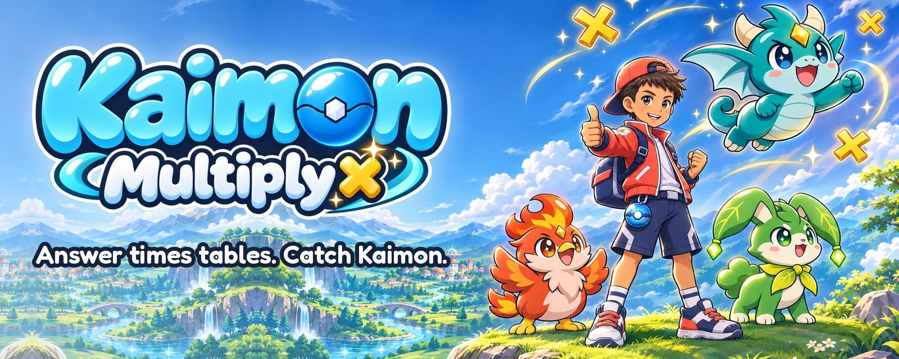
  </a>
</p>

<h1 align="center">Kaimon Multiply</h1>

<p align="center">
  <b>A times tables game where every right answer throws a ball.</b><br>
  Practice 1 × 1 to 10 × 10, catch 60 original creatures, beat the Gym Leaders.
</p>

<p align="center">
  <a href="https://brwilliams88.github.io/kaimon-multiply/"><b>▶&nbsp; Play now, free in your browser</b></a>
</p>

<p align="center">
  Free &nbsp;·&nbsp; No ads &nbsp;·&nbsp; No account needed &nbsp;·&nbsp; Works offline &nbsp;·&nbsp; iPad, iPhone, Android, Chromebook
</p>

---

## What it is

Kaimon Multiply turns times tables into a collecting adventure. A flashcard shows up with a wild Kaimon on it. Type the answer (or say it). Get it right and your trainer throws a ball to catch it. Get it wrong and the card flips to show the answer and a quick trick from Teacher K.

It was made for Kai, an 8 year old learning his times tables, and shared with his friends. It suits any kid who is learning or polishing their multiplication facts.

The rule behind every design choice: **most of the time is spent answering cards, and every reward comes from answering.** Even battles are flashcard battles. There is no trading, no map to wander and no leaderboard.

<p align="center">
  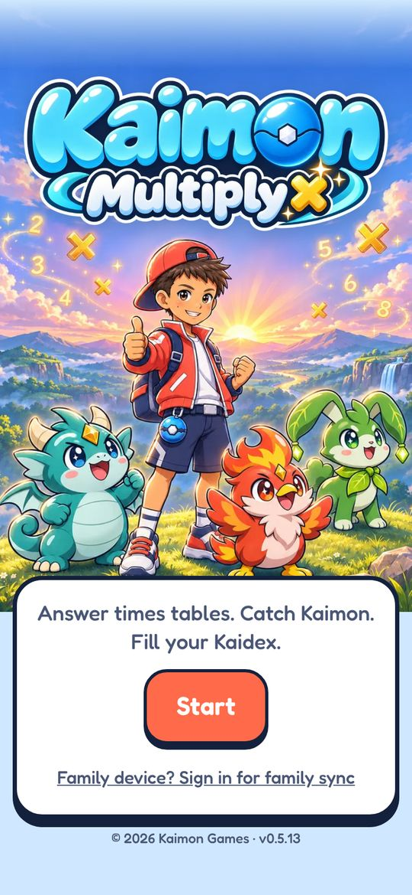&nbsp;
  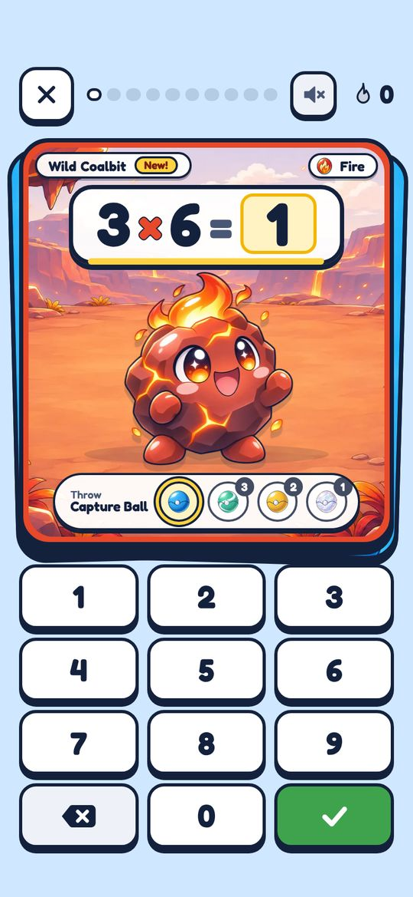&nbsp;
  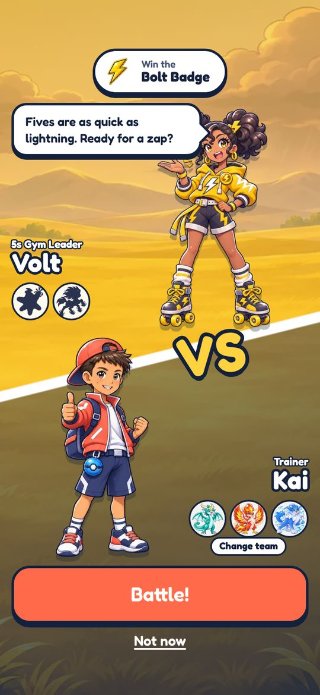&nbsp;
  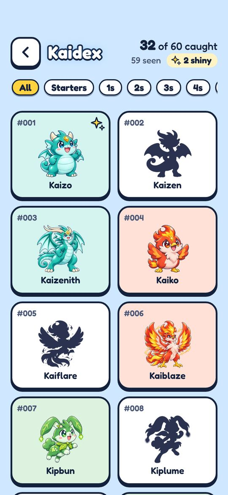
</p>
<p align="center"><sub>Title screen &nbsp;·&nbsp; A practice card &nbsp;·&nbsp; Gym Leader face-off &nbsp;·&nbsp; The Kaidex</sub></p>

## Meet the Kaimon

Pick one of three starters on day one. It becomes your Buddy, earns XP with every right answer and evolves twice as it levels up.

<table align="center">
  <tr>
    <td align="center"><br><b>Kaizo</b><br><sub>Dragon</sub></td>
    <td align="center">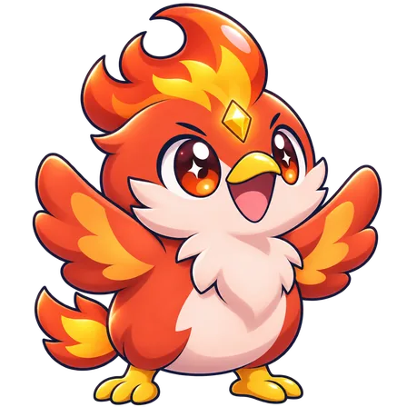<br><b>Kaiko</b><br><sub>Fire</sub></td>
    <td align="center">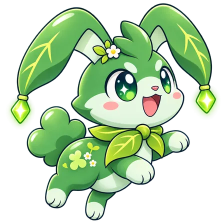<br><b>Kipbun</b><br><sub>Grass</sub></td>
  </tr>
</table>

Then go find the rest. Every times table is a region with its own Kaimon living in it.

<p align="center">
  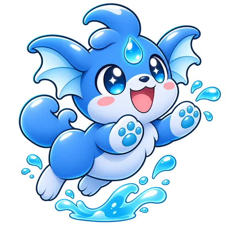
  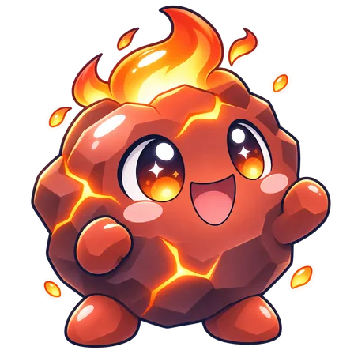
  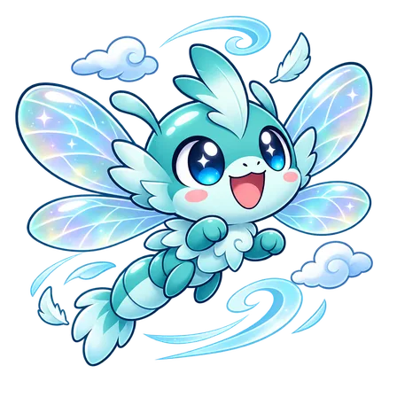
  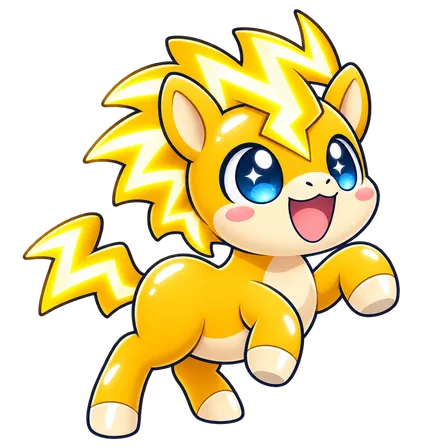
  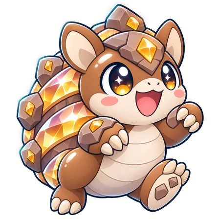
  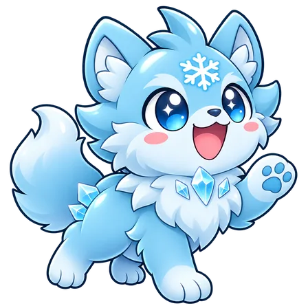
  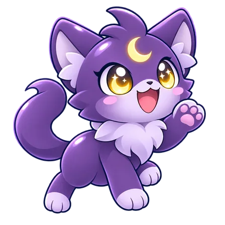
  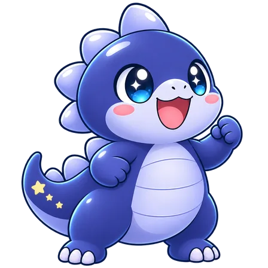
</p>
<p align="center"><sub>Puddlepup · Coalbit · Zippit · Voltfoal · Gemmo · Flurrypup · Kittnyx · Twinklesaur</sub></p>

## Meet the trainers

<table align="center">
  <tr>
    <td align="center">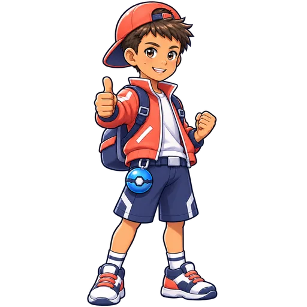<br><b>Kai</b><br><sub>The hero trainer</sub></td>
    <td align="center"><br><b>Teacher K</b><br><sub>Your mentor</sub></td>
    <td align="center">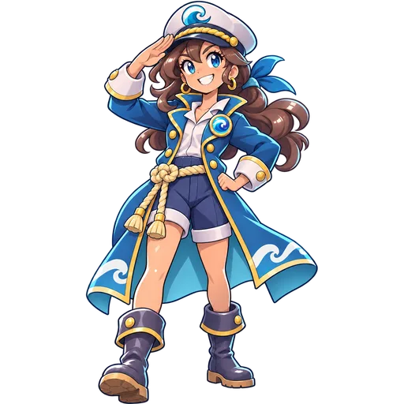<br><b>Captain Tide</b><br><sub>2s Gym Leader</sub></td>
    <td align="center">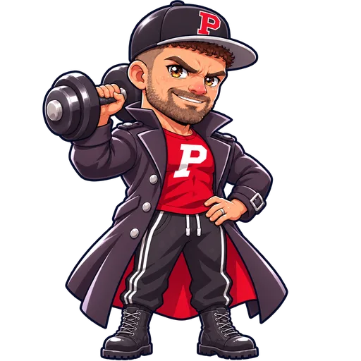<br><b>Boss Papa</b><br><sub>The final boss</sub></td>
  </tr>
</table>

## How it plays

**Practice cards.** A round is 10 cards by default. Tap the number pad, or turn on **Mic mode** and just say each answer. Fast, right answers throw harder and earn more XP.

**Catching.** Every right answer throws a ball at the Kaimon on the card. Rare Kaimon are harder to catch, so better balls help. About 1 in 32 catches is a **shiny**, a rare sparkly color.

**Ball tiers.** Balls get cooler as they get stronger:

| Ball | Look | How you get it |
|---|---|---|
| Capture Ball | Blue | Always free, never runs out |
| Super Ball | Emerald and white | 5 right in a row, or a battle reward |
| Mega Ball | Gold | 10 right in a row, a first Gym win, or a Pop Quiz win |
| Legend Ball | Prismatic diamond | Beat Boss Papa |

**Streaks.** A flame in the corner counts right answers in a row. Hot streaks upgrade your free throw.

**Regions.** Ten regions, one per times table, from Mossy Meadow (1s) to Starfall Summit (10s). Each has its own type, scenery and Kaimon. As your medals in a region climb, its rarer evolved Kaimon start to show up.

**Gym Leaders and badges.** Each region has a Gym Leader, starting with Little Leader Nozomi in the 1s. Battles are flashcard battles: every move is an answer, and faster answers hit harder. Win to earn the region's badge.

**Papa's Gym.** Beat every Gym Leader to unlock the final gym, where Boss Papa and Papazilla wait. Watch out for Team Papa along the way: they jump out during practice and always tell a dad joke.

**Teacher K.** She gives you your Buddy, explains how to play and teaches a trick whenever you miss a card. Once a week she runs a **Pop Quiz** battle built from the facts that keep getting away from you.

**The Kaidex.** Your collection of all 60 Kaimon. Ones you have only spotted show as dark silhouettes until you catch them. A few legendaries live in the Hundred Tower, and one very special Kaimon flies by now and then.

**Medals.** Each fact earns a medal, and medals need right answers on separate days, so they can't be rushed in one sitting:

| Medal | What it takes |
|---|---|
| 🥉 Bronze | Right on 2 separate days |
| 🥈 Silver | Right and fast on 5 separate days |
| 🥇 Gold | Right and fast on 10 separate days |
| ⭐ Star | Right and fast on 20 separate days, with no misses in the last week |

**Make your own trainer.** Play as Kai, pick one of 14 ready-made trainers, or build your own: 12 hairstyles, 3 outfits, 7 skin tones, 9 hair colors and 9 jacket colors. Your trainer shows up in battles and throws the ball on every catch.

## For grown-ups

**Privacy, in plain words**

- **No account needed.** Kids pick a trainer name and play. A friend can play as a guest, and guest progress never leaves the device.
- **Family sync is optional, and open to any family.** A grown-up signs in with their email and a code, then uses the same email on each device (phones, tablets, Chromebooks) to keep progress in step. Each family can only reach its own data.
- **News emails are easy to stop.** When a grown-up turns on family sync, a checked box adds their email to occasional news (they can uncheck it). There's an off switch in Grown-ups, and every news email has an unsubscribe button that deletes the address. Emails added for weekly reports are never put on the news list.
- **The mic never records.** Mic mode only listens while a card is waiting for an answer, and turns itself off after 2 minutes of quiet. Speech goes to the device's own speech service to become a number. Audio is never recorded or saved.

**The Grown-ups area** is behind a parent PIN (press and hold Grown-ups in the Menu). In it you can:

- See all 100 facts by medal, so you know which ones need work
- Choose which times tables are in play, cards per session and what counts as fast
- See play time by day and set a **daily time limit** (a round always finishes first)
- Give a **Good Work Stamp** for great math work done off screen, which earns in-game rewards
- Make backup codes, manage trainers and read what's new

**How it helps kids learn**

- **Spaced practice.** Medals count separate days, so learning is spread out over weeks, which is how facts stick.
- **Right and fast.** Higher medals need quick answers, which builds real recall instead of counting on fingers.
- **More practice where it's needed.** Facts with lower medals come up more often. Mastered facts still return now and then.
- **Every reward comes from answering.** Catches, XP, balls, badges and evolutions all come from answering cards.
- **Kind on misses.** A wrong answer shows the right one with a trick to remember it. No timer ever runs out on a card.

## How it's made

- **Plain JavaScript, no build step.** HTML, CSS and JavaScript modules served as they are.
- **An installable web app.** Add it to the home screen on iPad, iPhone, Android or a Chromebook. A service worker caches everything for offline play. Art sits in its own cache keyed by content hash, so an update only downloads the art that changed.
- **Hosted free on GitHub Pages.** Running cost is $0.
- **Art made once, offline.** Every Kaimon, trainer and scene was generated at build time in one locked friendly anime style, then exported to small WebP files. Nothing is generated while you play.
- **Family sync on a small database** with row-level security. Every answer, catch and reward is an event in an append-only log, so devices merge cleanly without overwriting each other.

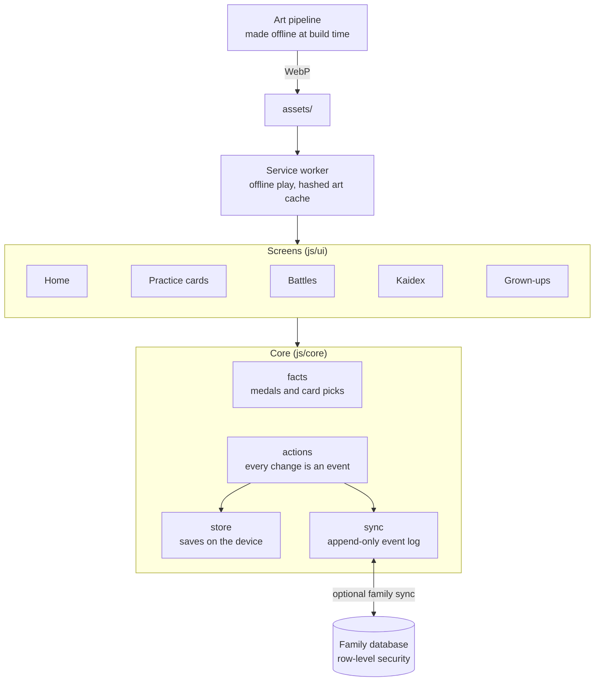

## Project layout

```text
index.html          The one page the app runs in
css/                All styles (app.css)
js/app.js           Starts the app and routes between screens
js/core/            Game rules: facts and medals, events, saves, sync, XP, battles, sound
js/ui/              Screens: home, practice, battles, Kaidex, trainer creator, grown-ups
js/data/            Kaimon and regions, dad jokes, the in-app changelog
assets/             WebP art: Kaimon, trainers, balls, badges, scenes, title
fonts/              Self-hosted Fredoka
tools/gen-sw.mjs    Rebuilds the offline file list in sw.js
```

## Run it locally

```bash
git clone https://github.com/brwilliams88/kaimon-multiply.git
cd kaimon-multiply
python3 -m http.server 8000
```

Then open <http://localhost:8000>. Any static server works.

Before committing a change, run `node tools/gen-sw.mjs` so offline caching picks it up.

## Versions

Every change a player or parent could notice ships as its own version, tagged `vX.Y.Z`. See [CHANGELOG.md](CHANGELOG.md) for the full history, or open **Grown-ups > What's new** in the app. Version 1.0.0 will be the public launch.

---

<p align="center">
  <br>
  Made by a dad and his son Kai, one times table at a time.
</p>
