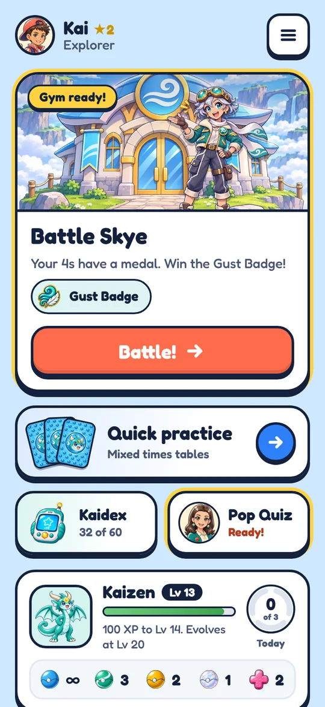
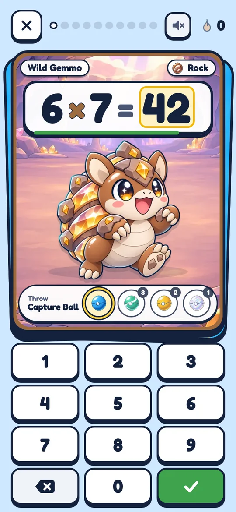
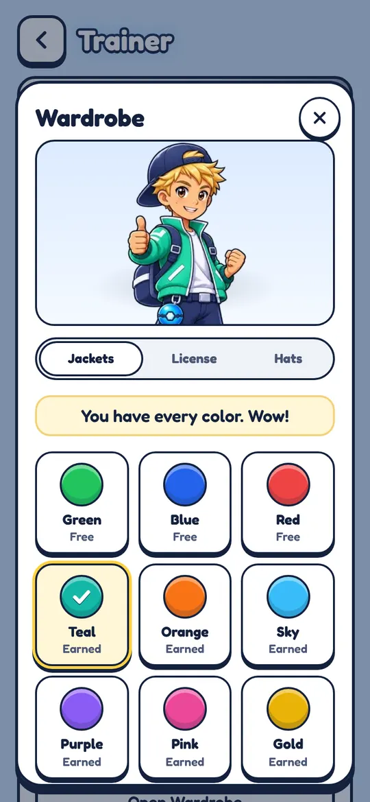

  

<h3 align="center">Free times tables practice for kids: answer 1 × 1 to 10 × 10, catch 60 original creatures, win a badge for every table.</h3>

  

  <a href="https://brwilliams88.github.io/kaimon-multiply/">brwilliams88.github.io/kaimon-multiply</a> 
  Free · No ads · No account needed · Works offline · iPad, iPhone, Android, Chromebook

  
  
  

<b>Home</b> &nbsp;·&nbsp; <b>Practice card</b> &nbsp;·&nbsp; <b>Gym battle</b>

  
  
  

<b>Kaidex</b> &nbsp;·&nbsp; <b>Wardrobe</b> &nbsp;·&nbsp; <b>Grown-ups</b>

## What it is

Kaimon Multiply is a times tables game. A flashcard shows up with a wild Kaimon on it. Type the answer, or say it out loud. Get it right and your trainer throws a ball to catch it. Get it wrong and the card shows the answer and a quick trick from Teacher K.

It was made for Kai, an 8 year old learning his times tables, and shared with his friends. The rule behind every choice: **most of the time is spent answering cards, and every reward comes from answering.** Battles are flashcard battles where every move is an answer. No trading, no maps to wander, no leaderboards.

## What's in the game

- **A guided first game.** Teacher K walks new trainers through four easy cards, a first catch and a quick look around Home.
- **60 original Kaimon** across 10 regions, one region for each times table. Every Kaimon you own has its own level. Pick one as your **Buddy**, and watch it grow and evolve.
- **Gyms and Boss Papa.** Each table has a Gym Leader with a badge to win. Faster answers hit harder. Beat them all to face Boss Papa and his dad jokes at Papa's Gym.
- **The Hundred Tower and Megas.** Climb floors of legendary Kaimon. Each new floor gives a Mega Crystal for a stronger Mega form.
- **Lightning Round.** 60 seconds with facts you already know. Beat your own best. Always optional, and Calm mode in Grown-ups hides it.
- **Items and daily quests.** Three small quests a day, all done by answering. Earn Hint Scrolls, Power Snacks, Evolve Crystals and more.
- **Your own trainer and Wardrobe.** Play as Kai or build your own look, then earn new jacket colors with right answers.
- **Works offline.** Once every picture is saved, the whole game plays with no internet. The Menu shows a Works offline badge.

## How it helps kids learn

- **Spaced practice.** Medals count right answers on separate days (Bronze 2, Silver 5, Gold 10, Star 20), so facts are learned over weeks instead of crammed. A missed fact comes back a little later, then again a bit later.
- **Foundations first.** New facts come in a proven order: the 1s, 2s, 5s and 10s, then squares like 6 × 6, then the rest. Each round mixes a few new or tricky facts in with ones a child already knows.
- **Turnaround facts.** Know 7 × 3? The game points out that 3 × 7 is the same answer, so 100 facts feel more like 55.
- **Accuracy before speed.** Bronze only needs right answers. Higher medals need quick ones too, which builds real recall instead of counting on fingers. No timer ever runs out on a practice card.
- **Kind on misses.** A wrong answer shows the right one with one short trick, and the child types it in before moving on.

## For grown-ups

- **Grown-ups area** behind a parent PIN. See the last 7 days at a glance, one thing to practice next, one piece of good news, all 100 facts by medal and a "Talk about it" question to try with your child. Pick which tables are in play, set a daily time limit and give a **Good Work Stamp** for great math done off screen.
- **Weekly email.** Optional. A short summary each Sunday morning for up to 5 grown-ups. Each person taps Yes in a first email before any report comes.
- **Family sync.** Optional. Start a family from Grown-ups with a grown-up's email and a one-time code, and the same trainers stay in step on every family phone, tablet and Chromebook.
- **Play on another device.** A QR code and link to open the game on another phone, tablet or Chromebook.
- **Share with a class.** A page for teachers and families with a QR code, privacy in plain words and a one-page letter to print. Find it in Grown-ups, on the Help tab.
- **No ads, no purchases, no cost.** The game is free and runs for $0.

## Privacy, in plain words

The short version, from the [Privacy page](https://brwilliams88.github.io/kaimon-multiply/privacy.html):

- **No ads.** We never sell or share your data. No tracking cookies and no third-party trackers.
- **No account needed.** Progress stays on your device. Friends can play as guests, and guest progress never leaves the device.
- **Emails only go to grown-ups who sign up**, and every email has a way to stop. Emails typed in for weekly reports are never added to the news list.
- **Usage counts, with an off switch.** To see if the game is fun and working, it sends simple counts to a private dashboard, like a random number made for the device (not linked to any email), trainer names, the kind of device, a rough city and play totals. Never emails, names of real people, photos or exact locations. A grown-up can turn this off in Grown-ups, on the Help tab.
- **Family sync** stores the family's trainers and progress so every family device stays in step. Each family can only see its own trainers.

## Install on a phone, tablet or Chromebook

Open [the game](https://brwilliams88.github.io/kaimon-multiply/), then:

- **iPad or iPhone:** tap **Share**, then **Add to Home Screen**.
- **Android:** tap the menu, then **Install app**.
- **Chromebook or computer:** click the install icon at the right end of the address bar in Chrome or Edge.

The [Install page](https://brwilliams88.github.io/kaimon-multiply/install.html) has steps for every device. Once installed it opens full screen and works offline.

## How it was built

- **Run like a real product.** A short brief with firm product rules (mostly answering, every reward from answering, original creatures only), a roadmap in phases, playtests with Kai, and every change a player could notice shipped as its own version.
- **Claude as the team.** The game was written with Claude Code. Parallel agents each built one feature in their own git worktree, checked their work with automated screenshots at phone and iPad sizes, and handed back to a coordinator that merged and shipped.
- **Art made offline** with OpenAI's image model, once, at build time, in one friendly anime style. Nothing is generated while you play. Sound and music are made in code with the Web Audio API.
- **$0 to run.** Hosted free on **GitHub Pages**. Family sync and usage counts use **Supabase** on its free plan, and weekly emails go out through **Google Apps Script**.

## For developers

Kaimon Multiply is a static, installable web app in plain HTML, CSS and JavaScript modules. There is no build step.

- **Run it:** serve the folder with any static server, for example `python3 -m http.server 8000`, then open <http://localhost:8000>.
- **Before committing:** run `node tools/gen-sw.mjs` so the service worker caches the latest files for offline play.
- **Tests:** `node --test tests/*.test.mjs` (items, quests, Lightning Round, tower), plus `node tools/test-learning.mjs` and `node tools/test-levels.mjs`. `tools/` also has pacing simulators and the Apps Script mailer.
- **Layout:** `js/core` holds the game rules (the reusable Kaimon core, with the math in `js/core/facts.js`), `js/ui` the screens, `js/data` the creatures and text, and `supabase/` the database setup with row-level security. Progress is an append-only log of events, so devices merge cleanly.

## Versions

Every change a player or parent could notice ships as its own version, tagged `vX.Y.Z`. Version 1.0.0 is the public launch. See the [changelog](CHANGELOG.md) for the full history, or open **Grown-ups > What's new** in the app.

---

   
  Made by a dad and his son Kai, one times table at a time. Fredoka font by The Fredoka Project Authors (SIL Open Font License 1.1).

