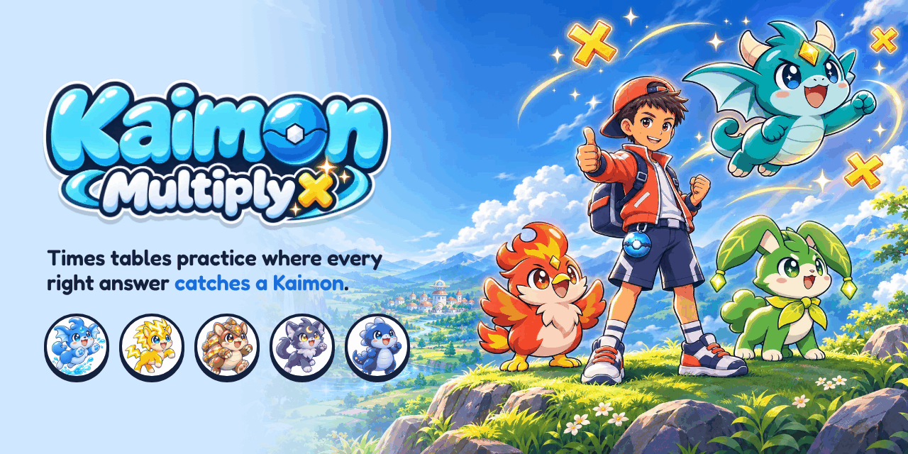
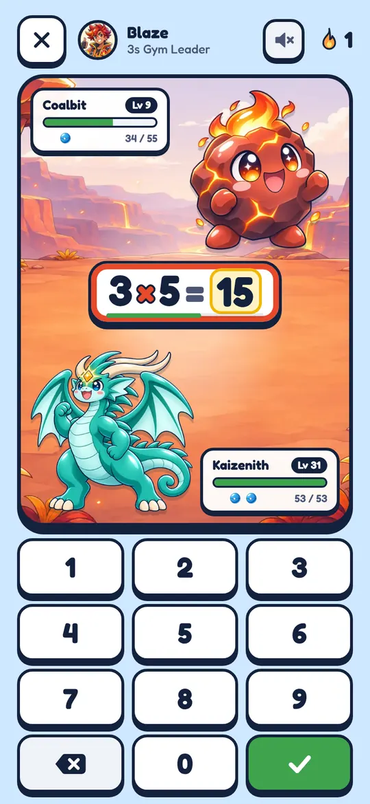
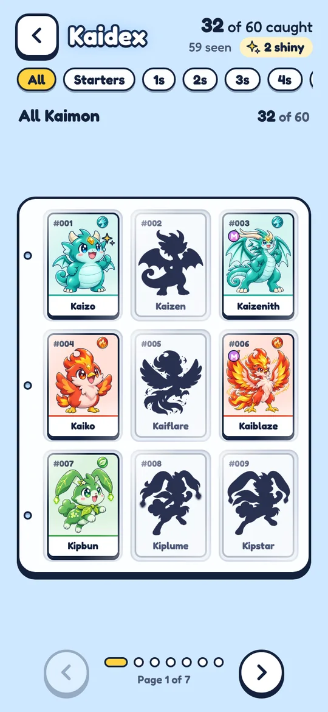
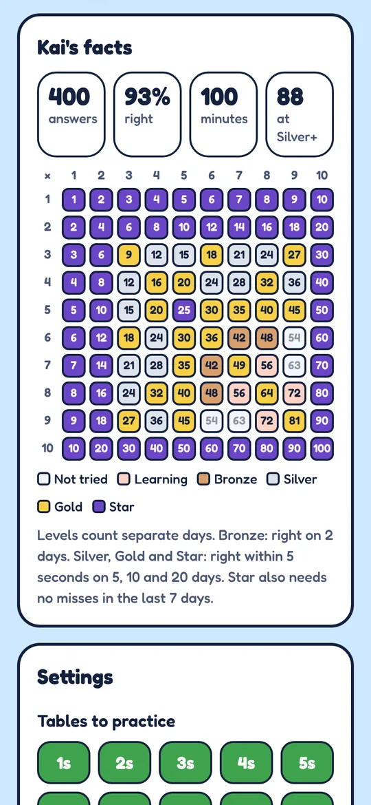

  

<h3 align="center">Free times tables practice for kids: answer 1 × 1 to 10 × 10, catch 60 original creatures, win a badge for every table.</h3>

  

  <a href="https://brwilliams88.github.io/kaimon-multiply/">brwilliams88.github.io/kaimon-multiply</a> 
  Free · No ads · No account needed · Works offline · iPad, iPhone, Android, Chromebook

  
  
  
  
  

<b>Home</b> &nbsp;·&nbsp; <b>Practice card</b> &nbsp;·&nbsp; <b>Gym battle</b> &nbsp;·&nbsp; <b>Kaidex</b> &nbsp;·&nbsp; <b>Grown-ups</b>

## What it is

A flashcard shows up with a wild Kaimon on it. Type the answer, or say it out loud. Get it right and your trainer throws a ball to catch it. Get it wrong and the card flips to show the answer and a quick trick from Teacher K.

- **60 original Kaimon** to catch, across 10 regions, one for each times table from 1s to 10s.
- **Gym Leaders and badges.** Battles are flashcard battles: every move is an answer, and faster answers hit harder. Beat them all to face Boss Papa.
- **Your own trainer.** Play as Kai or build your own look.

It was made for Kai, an 8 year old learning his times tables, and shared with his friends. The rule behind every choice: **most of the time is spent answering cards, and every reward comes from answering.** No trading, no maps to wander, no leaderboards.

## How it helps kids learn

- **Spaced practice.** Medals count right answers on separate days (Bronze 2, Silver 5, Gold 10, Star 20), so facts are learned over weeks instead of crammed. A missed fact comes back a little later, then again a bit later.
- **Foundations first.** New facts come in a proven order: the 1s, 2s, 5s and 10s, then squares like 6 × 6, then the rest. Each round mixes a few new or tricky facts in with ones a child already knows.
- **Turnaround facts.** Know 7 × 3? The game points out that 3 × 7 is the same answer, so 100 facts feel more like 55.
- **Accuracy before speed.** Bronze only needs right answers. Higher medals need quick ones too, which builds real recall instead of counting on fingers. No timer ever runs out on a card.
- **Kind on misses.** A wrong answer shows the right one with one short trick, and the child types it in before moving on.

## For grown-ups

- **Parent PIN area.** Open Grown-ups from the Menu and enter the PIN. See all 100 facts by medal, pick which tables are in play, set a daily time limit and give a **Good Work Stamp** for great math done off screen.
- **Weekly reports.** Turn them on to email a short summary each Sunday morning to up to 5 grown-ups. Each person taps Yes in a first email before any report comes.
- **Family sync.** Optional. Sign in with a grown-up's email and a code, and the same trainers stay in step on every family phone, tablet and Chromebook.
- **No ads, no purchases, no cost.** The game is free and runs for $0.

**Privacy, in plain words**

- **No account needed.** Kids pick a trainer name and play. Without family sync or weekly reports, progress stays on the device. Friends can play as guests, and guest progress never leaves the device.
- **Family sync** keeps the grown-up's email (only used to sign in) and the synced trainers' names and progress. Each family can only reach its own data.
- **Weekly reports** keep only the email addresses, so we know who said yes. The summary itself is not kept on a server. Turn reports off any time in Grown-ups.
- **News emails are easy to stop.** When a grown-up turns on family sync, a checked box adds their email to occasional news (they can uncheck it). There is an off switch in Grown-ups, and every news email has an unsubscribe button that deletes the address. Emails added for weekly reports are never put on the news list.
- **The mic never records.** Mic mode only listens while a card is waiting for an answer, and turns itself off after 2 minutes of quiet. Speech goes to the device's own speech service to become a number. Audio is never recorded or saved.

## Install on a phone, tablet or Chromebook

Open [the game](https://brwilliams88.github.io/kaimon-multiply/), then:

- **iPad or iPhone:** tap **Share**, then **Add to Home Screen**.
- **Android:** tap the menu, then **Install app**.
- **Chromebook or computer:** click the install icon at the right end of the address bar in Chrome or Edge.

Once installed it works offline. The game also shows the steps for your exact device in **Grown-ups > Install on this device**.

## Built with

- **An installable web app** in plain HTML, CSS and JavaScript, with no build step. Hosted free on **GitHub Pages**. A service worker caches everything for offline play.
- **Supabase** for optional family sync, with row-level security. Progress is an append-only log of events, so devices merge cleanly.
- **Google Apps Script** to send the weekly report emails.
- **Art made offline with image generation**, once, at build time, in one friendly anime style. Nothing is generated while you play.
- **Sound and music synthesized in code** with the Web Audio API. There are no audio files.

To run it locally, serve the folder with any static server (for example `python3 -m http.server 8000`) and open <http://localhost:8000>. Run `node tools/gen-sw.mjs` before committing so offline caching picks up changes.

## Versions

Every change a player or parent could notice ships as its own version, tagged `vX.Y.Z`. See the [changelog](CHANGELOG.md) for the full history, or open **Grown-ups > What's new** in the app. Version 1.0.0 will be the public launch.

---

   
  Made by a dad and his son Kai, one times table at a time. Fredoka font by The Fredoka Project Authors (SIL Open Font License 1.1).

